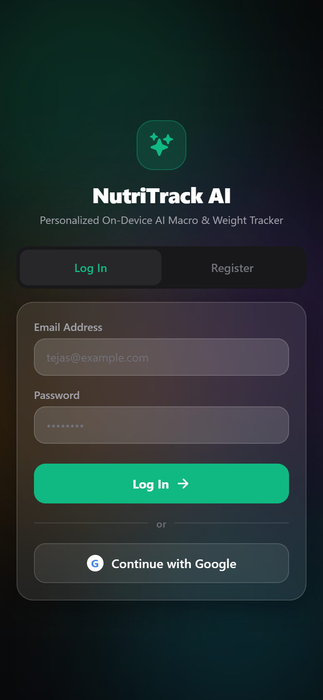
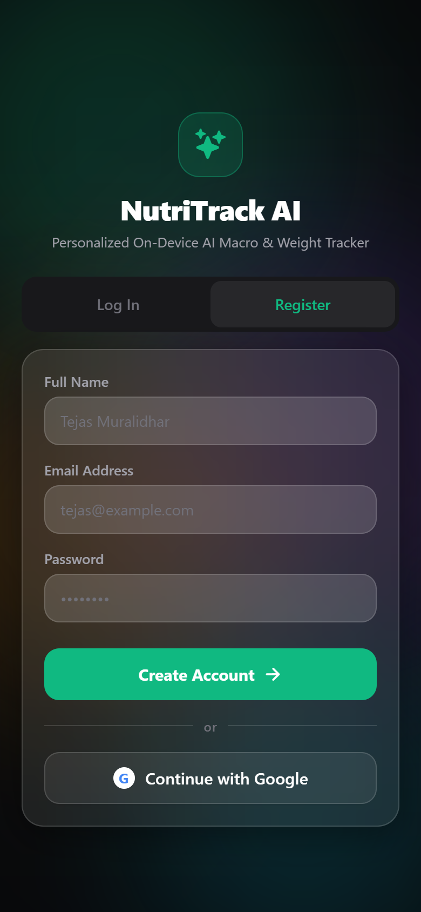
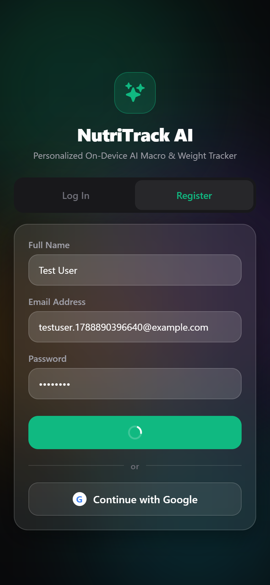
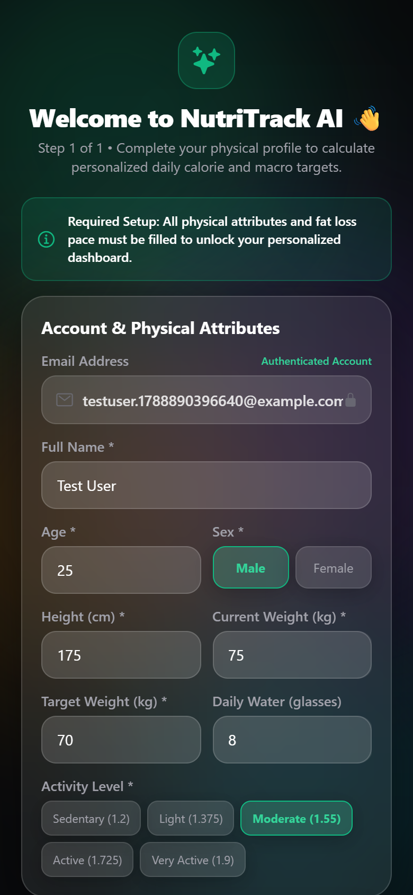
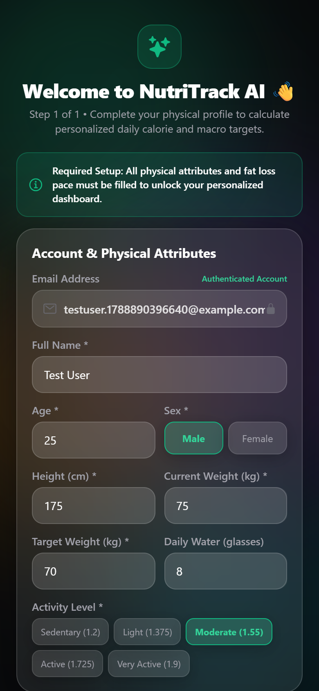
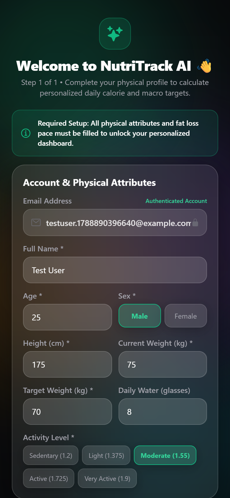
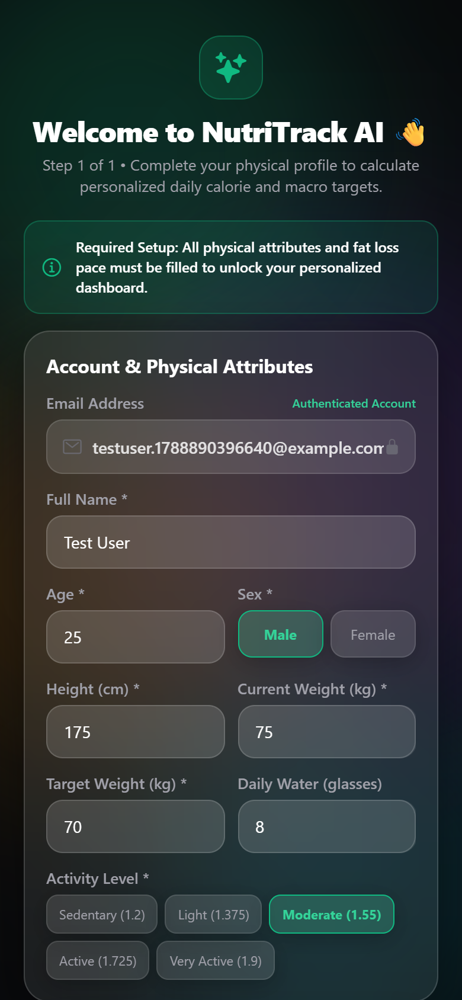

# 🥗 NutriTracker AI

> **Intelligent AI-Powered Nutrition, Macro & Workout Companion**  
> Built with Expo, React Native, Firebase, and Google Gemini Multimodal AI.

---

## 📌 Overview

**NutriTracker AI** is an advanced mobile and web application designed to simplify meal tracking, macro estimation, workout logging, and health analytics. Leveraging Google Gemini 3.x vision & natural language models, NutriTracker AI eliminates manual food entry by instantly parsing meal photos or text descriptions into itemized macro breakdowns.

---

## 📱 App Preview

### 🔐 Authentication & Setup

<table align="center">
  <tr>
    <td align="center" width="33%">
      <br />
      <sub><b>Login Screen</b></sub>
    </td>
    <td align="center" width="33%">
      <br />
      <sub><b>Registration Form</b></sub>
    </td>
    <td align="center" width="33%">
      <br />
      <sub><b>Onboarding Wizard</b></sub>
    </td>
  </tr>
</table>

### 📊 Dashboard & Food Logging

<table align="center">
  <tr>
    <td align="center" width="33%">
      <br />
      <sub><b>Home Dashboard</b></sub>
    </td>
    <td align="center" width="33%">
      <br />
      <sub><b>Add Food Modal</b></sub>
    </td>
    <td align="center" width="33%">
      <br />
      <sub><b>Food Diary Log</b></sub>
    </td>
  </tr>
</table>

### 🏋️ Workout & Weight Tracking

<table align="center">
  <tr>
    <td align="center" width="33%">
      <br />
      <sub><b>Log Workout Modal</b></sub>
    </td>
    <td align="center" width="33%">
      <br />
      <sub><b>Workout History</b></sub>
    </td>
    <td align="center" width="33%">
      <br />
      <sub><b>Log Weight Modal</b></sub>
    </td>
  </tr>
</table>

### 📈 Progress Analytics & Profile

<table align="center">
  <tr>
    <td align="center" width="50%">
      <br />
      <sub><b>Progress Analytics</b></sub>
    </td>
    <td align="center" width="50%">
      <br />
      <sub><b>Profile & Settings</b></sub>
    </td>
  </tr>
</table>

---

## 🚀 Workspace Structure

```
NutriTracker AI/
├── mobile/                  # Expo / React Native cross-platform application
│   ├── assets/              # App branding assets & splash screens
│   ├── src/                 # Application codebase (screens, components, services, context)
│   ├── app.json             # Expo app configuration
│   ├── capacitor.config.json# Capacitor native config
│   ├── package.json         # Dependencies & scripts
│   └── README.md            # Detailed mobile app documentation
└── README.md                # Project repository overview
```

---

## ⚡ Quick Start

```bash
# 1. Navigate to the mobile application directory
cd mobile

# 2. Install dependencies
npm install

# 3. Configure environment variables (.env)
cp .env.example .env
# Set EXPO_PUBLIC_GEMINI_API_KEY=your_gemini_api_key

# 4. Launch development server
npx expo start
```

For complete feature descriptions, architecture details, and configuration instructions, please refer to [mobile/README.md](file:///c:/Users/Tejas/Desktop/NutriTracker%20AI/mobile/README.md).
